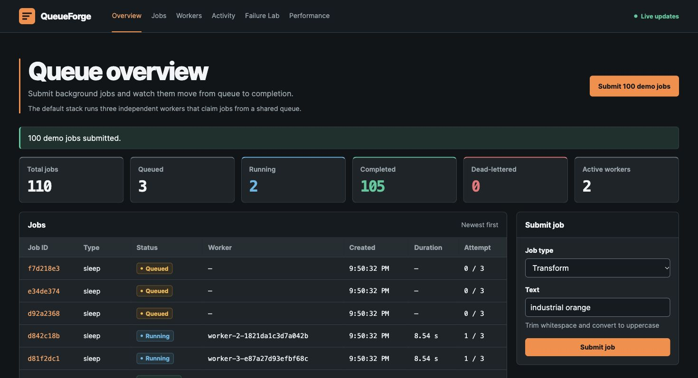
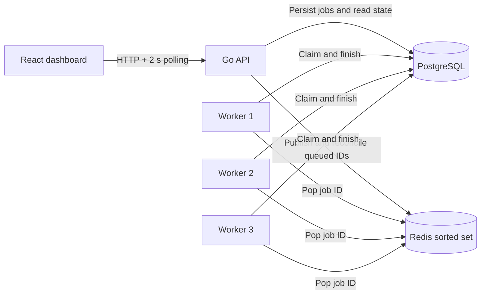
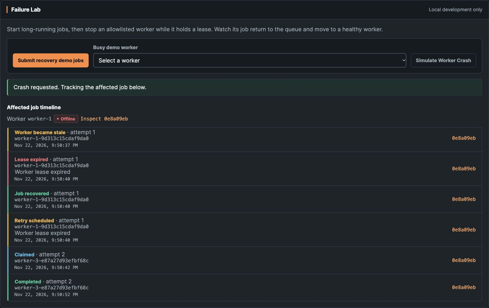
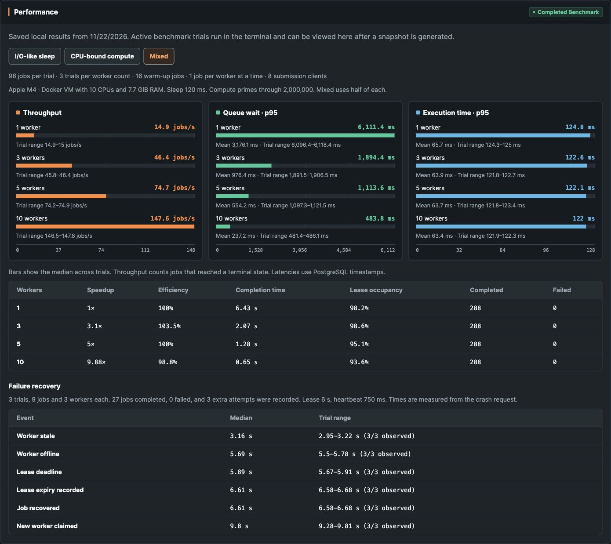

# QueueForge

QueueForge is a local distributed job engine. Submit a job from the dashboard or HTTP API, then watch independent Go workers dispatch, claim, and execute the workload. PostgreSQL stores job state, renewable leases, execution history, results, and worker heartbeats. Redis coordinates which job IDs workers receive.



## Run locally

From the QueueForge directory, with Docker and Docker Compose installed. If upgrading an existing Phase 1 stack, run `docker compose down` first and reuse your existing `.env`. The API applies migrations at startup and preserves the PostgreSQL volume.

For a fresh setup, use a shell with OpenSSL available. The Docker Engine needs to be running before you start.

```sh
cp .env.example .env
printf '\nPOSTGRES_PASSWORD=%s\n' "$(openssl rand -hex 24)" >> .env
docker compose up --build -d --wait
```

Open [the dashboard](http://127.0.0.1:5173). The API defaults to [port 8080](http://127.0.0.1:8080/health). If another app is already on either port, set `DASHBOARD_PORT` or `API_PORT` in `.env`, rerun Compose, and open the corresponding `127.0.0.1` URL. Use the configured API port in the examples below. Keep the same PostgreSQL password for the lifetime of the local data volume.

```sh
docker compose ps
docker compose logs -f worker-1 worker-2 worker-3
docker compose down
```

The PostgreSQL volume persists across `down` and subsequent starts.

## Try the workload

Click **Submit 100 demo jobs** in the dashboard, or submit a batch through the API:

```sh
curl -fsS http://127.0.0.1:8080/api/demo \
  -H 'Content-Type: application/json' \
  -d '{"count":100}'
```

The batch mixes short sleep jobs with prime counting and text transformations. Watch the running count and worker assignments as jobs execute across the three containers.

Submit a single job:

```sh
curl -fsS http://127.0.0.1:8080/api/jobs \
  -H 'Content-Type: application/json' \
  -d '{"type":"sleep","payload":{"duration_ms":1500}}'
```

| Type | Payload | Result |
| --- | --- | --- |
| `sleep` | `{"duration_ms":1500}`, integer from 1 to 10,000 | Milliseconds requested |
| `compute` | `{"limit":1000000}`, integer from 2 to 2,000,000 | Number of primes up to and including the limit |
| `transform` | `{"text":"  example  "}`, up to 4,096 UTF-8 bytes without NUL | Trimmed, uppercased text |

All handlers are built in and run with a 12-second execution context. The HTTP request body is capped at 16 KiB, and each payload is capped at 8 KiB.

## Features and architecture



Go's standard HTTP server handles the API. pgx connects to PostgreSQL, and go-redis connects to Redis. The TypeScript dashboard builds with Vite and is served by Nginx in Compose.

1. Submission commits the job to PostgreSQL, including its retry policy and optional idempotency key. The API then publishes the ID to Redis. Each second the API also reconciles up to 500 eligible queued jobs.
2. Independent workers pop job IDs from Redis. PostgreSQL atomically grants each claim a lease, increments the attempt count, and issues a new fencing token. Workers periodically heartbeat and renew their current lease.
3. Completion and renewal require the worker generation, token, and a live lease. A recovery scan locks expired rows, releases ownership and schedules eligible retries. Once the retry budget is exhausted, PostgreSQL records a terminal failure.
4. Durable history records attempts and lifecycle transitions. The dashboard polls the API and shows worker health, current jobs, lease deadlines, failures, and the recovery timeline.

See [the consistency and failure model](docs/consistency.md) and [dashboard screenshots](docs/screenshots/README.md).

## Failure Lab



Use the opt-in Compose override for an explicitly local, disposable stack.

```sh
docker compose -f docker-compose.yml -f docker-compose.lab.yml up --build -d --wait
```

Open [the dashboard](http://127.0.0.1:5173/#failure-lab). Click **Submit recovery demo jobs**, select a busy worker, then click **Simulate Worker Crash**. The affected job timeline follows the real database state through stale worker detection, lease expiry, retry scheduling, and reassignment. The crashed container stays stopped. Restart the corresponding service by substituting its name in this example.

```sh
docker compose -f docker-compose.yml -f docker-compose.lab.yml start worker-1
```

The simulator accepts only the fixed `worker-1`, `worker-2`, and `worker-3` slots. Opted-in workers act only on requests for their own process generation. The request sets a database flag, freezes lease writes for the affected attempt, and causes the worker to exit abruptly at its next heartbeat. Neither the API nor workers have a Docker socket, and the endpoint accepts no OS process IDs, container names, or commands. The long-running batch uses `POST /api/demo` with `{"count":9,"profile":"failure"}`. The custom `X-QueueForge-Demo: 1` header prevents ordinary cross-origin form submissions and serves as an explicit opt-in marker for API callers. Keep the lab on a trusted local machine.

To run and record the same exercise from the command line, start the lab with three healthy workers. The script waits for existing jobs to drain before it submits the workload.

```sh
python3 scripts/verify_failure_lab.py --url http://127.0.0.1:5173
```

Substitute your dashboard port if configured. To switch back to normal mode, run `docker compose up -d --wait` without the lab override.

Timing is configurable through Compose environment variables. Defaults are `HEARTBEAT_INTERVAL=750ms`, `WORKER_STALE_AFTER=2500ms`, `WORKER_OFFLINE_AFTER=5s`, and `JOB_LEASE=6s`. The API scans once a second. Stale and offline thresholds must be strictly ordered below the lease duration and the heartbeat must be at most one-third of the lease and less than half the stale threshold.

## API

| Method | Path | Successful response |
| --- | --- | --- |
| POST | `/api/jobs` | `201` with the new job record and a `Location` header |
| POST | `/api/demo` | `201` with count and job records. Send `{"count":100}` for a batch of 1–100 |
| GET | `/api/jobs?limit=25&offset=0` | Jobs ordered newest first, with `limit`, `offset`, and `has_more`. Maximum limit is 100 |
| GET | `/api/jobs/{id}` | One job with payload, timestamps, worker, result, and error |
| GET | `/api/workers` | Worker generations, heartbeat timestamps, reported state, health, and active job IDs |
| GET | `/api/jobs/{id}/history` | Full durable timeline for a job |
| GET | `/api/history` | Latest 50 durable events across jobs and workers |
| POST | `/api/jobs/{id}/retry` | `202` when a dead-lettered job is requeued with a fresh retry budget |
| GET | `/api/failure-lab` | Whether local demo mode is enabled |
| POST | `/api/failure-lab/crash` | `202` with target worker and job IDs after accepting `{"slot":"worker-1"}` in local demo mode |
| GET | `/api/metrics` | Job counts, reported active workers, average queue wait, and average run time |
| GET | `/api/activity` | Up to 20 recent job events |
| GET | `/health` | PostgreSQL and Redis connectivity, with `503` when degraded |

Errors use `{"error":{"code":"invalid_job","message":"..."}}`. Malformed JSON receives `400`, oversized bodies receive `413`, and invalid job payloads receive `422`.


`POST /api/jobs` accepts an optional `Idempotency-Key` header. A matching replay returns `200` with the original job's current state. Reuse with a different normalized payload or retry policy returns `409`. The optional `retry` object accepts `max_attempts` (1–10), `backoff_ms` (100–60000), and `max_backoff_ms` (base delay to 300000). The defaults are 3 total attempts, 500 ms base, and a 10-second cap. `failed` is the API's terminal dead-letter status. The dashboard displays it as **Dead-lettered**.

## Develop and test

Use Go 1.26+ and Node 22.12+ for local builds. Benchmark and Failure Lab scripts use Python 3.11+.

```sh
(cd backend && go mod download && go build ./... && go test ./... && go test -race ./... && go vet ./...)
(cd frontend && npm ci && npm run build)
docker compose --profile test run --rm tests go test -race -count=1 ./...
```

The local Go command skips the integration suite when its service URLs are absent. The Compose command runs both suites under the race detector. Compose runs the integration suite against PostgreSQL and Redis using a temporary PostgreSQL schema and a unique Redis key. To use your own test infrastructure, pass `TEST_DATABASE_URL` and `TEST_REDIS_URL` to `go test`; the test database user needs schema creation privileges.

For frontend development, run `npm run dev` from `frontend/` with an API already serving on port 8080. Set `QUEUEFORGE_API` to point at a different API origin.

## Operational limits

- Execution is at least once within the configured attempt budget. A worker that lost its lease may still be executing code. Fencing protects QueueForge database writes. Handlers that write to external systems would need their own idempotency or fencing.
- Demo workers stay offline after a crash until explicitly restarted. Offline history rows are retained.
- The local API has no authentication, retention policy, or multi-tenant isolation. Offset pagination can shift as new jobs arrive.

## Performance

The dashboard includes saved measurements for 1, 3, 5, and 10 workers under sleep, compute, and mixed workloads, plus repeated Failure Lab timings. Median throughput from one to ten workers on the local Apple M4 test host was sleep 8.00 to 76.80 jobs/s, compute 194.97 to 717.26 jobs/s, mixed 14.94 to 147.65 jobs/s. The benchmark runner reports active progress in the terminal and can generate a dashboard snapshot from validated raw data. These are short-burst, single-host measurements. Mixed-workload throughput improved **9.88×**, from **14.94 to 147.65 jobs per second**, and **27 of 27 jobs completed** across three measured worker-crash drills.



```sh
python3 scripts/benchmark.py --output .benchmark-local/results.json
python3 scripts/summarize_benchmarks.py .benchmark-local/results.json .benchmark-local/snapshot.json
```

The shipped benchmark evidence stays intact when you run these commands. To preview your run in the dashboard, copy the new snapshot to `frontend/public/benchmarks.json` and run `docker compose up --build -d --wait frontend`.

The Python benchmark validation suite runs with `python3 -m unittest discover -s scripts -p "test_*.py"`.

See [benchmark results and methodology](docs/benchmarks.md) and [engineering decisions](docs/engineering-decisions.md).

## License

[MIT](LICENSE)
